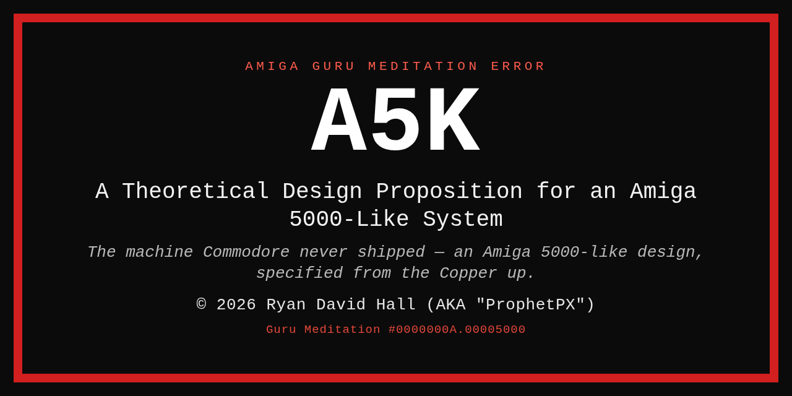

<p align="center">
  
</p>

# A5K — An Amiga-Inspired Deterministic Display and Audio Card

> *A PCIe video/audio engine with a Copper-style, slot-exact timing contract —
> specified from the beam up.*

A5K is a deterministic display and audio engine on a PCIe card, inspired by the
Amiga custom chipset. It is **not** an Amiga, not a console, and not a
compatibility project: no 68k, no Kickstart, no Amiga software claim.

The design study specifies the chipset method in enough detail to build, costed,
and argued against the alternatives — including the obvious one, *why not just use
a GPU*.

The relevant Amiga lineage is the video/audio workstation side — genlock, Video
Toaster, Scala, broadcast graphics, Copper-driven raster effects, deterministic
audio — not the games machine. Games are the loudest part of the community, not
the most relevant part.

**One architecture, three build points and a halo.** *A5K (C+)* is the entry
model — one beam, one output, the entry price. *A5K Studio* is the dual-beam
model — two beams, capture and a local NVMe buffer. *A5K Studio Pro* adds 4K
DisplayPort and 4:4:4 capture. *A5K Studio Pro II* is the halo: 512-bit fabric on
the same board. The comparison is one of position, not of compatibility or
features.

No hardware has been built. Everything here is a proposition — and
`TECHNICAL-CONSIDERATIONS.md` says so in engineering terms.

## What A5K is not

- not an Amiga
- not a console
- not a Kickstart/68k machine
- not a compatibility project
- not a games platform

A host may drive it, and a game could appear on a host, but that is not the target.

It is not a 1990s Amiga and not a clone, but it **is** a deliberate attempt to
define what future Amiga-like hardware should be able to be and do — the method,
not the product.

## Who it is for

- FPGA and video engineers
- deterministic display and audio work
- Copper-style raster and beam-synchronous experiments
- open-hardware people who care about the chipset method, not the logo

## Documents

| File | Pages | What it is |
|---|---|---|
| `A5K-Design-Proposition.pdf` | 19 | The main study, Rev. AW (B49) — architecture, chip-by-chip mapping, bus options, CPU choice, reference build, software, what you'd lose, the GPU question, and four appendices (Copper spec, Migen skeleton, bill of materials, where it is most likely wrong). |
| `A5K-Comparative-Addendum.pdf` | 4 | Comparative analysis — the A5K against AAA, Hombre, the shipped Amiga eras, and a 2026 scientific workstation. Tables A1–A4. |
| `A5K-Technical-Specifications.pdf` | 6 | Reference card — clocks, memory configurations and upgrade paths, processor options, bandwidth budget at 4K60, parallelism, video modes and recovery, and the ceilings that bound the design. Tables S1–S11. |
| `A5K-Slot-Table.md` | — | **How the bus is shared.** What a slot is, what the original did, what changes at 60 Hz, the 7.0714 MHz tick and why it is 148.5 ÷ 21, how DDR3L actually behaves (32-byte bursts, refresh, turnaround, ECC), the budget at 640×512 / 1080p / 4K, the 1080p line slot by slot, five acceptance tests, the reserved second tick domain, and the ceilings. |
| `A5K-Simulator-Specification.md` | — | **Phase 0.** The behavioural model to build before any RTL: what it models, what it deliberately does not, the trace format, and the five tests it has to pass — plus one that proves the tests can fail. |
| `A5K-Dual-Pipe-Arbitration.md` | — | **Two beams, one bus.** The superframe, the three tiers of claim, the starvation bounds a driver may rely on, and the mode pairs that are refused. |
| `A5K-Frailties.md` | — | **What to attack first.** One undefined item, eight unverified claims, six assumptions — each with severity, consequence and the test that would settle it. Start here if you intend to check the work. |
| `A5K-Brief.md` | — | **The plain-language brief.** A one-page answer for engineers outside the Amiga world: what the card is, what the slot schedule means, what the Copper is, the bandwidth numbers, and the narrow review wanted. |
| `A5K-AROS-68K-Plan.md` | — | **AROS, 68k and compatibility.** Three separate paths: native AROS on the host, host-emulated 68k, and an on-card 68k soft core with chipset compatibility — with requirements, effort, power/heat implications and a recommendation. |
| `A5K-Bus-Technology.md` | — | **Bus reference.** PCIe 1.0–7.0 bandwidth, CXL, NVLink, UALink, UCIe, UltraFusion, Infinity Fabric/UPI, HBM — and why A5K’s internal fabric, not PCIe, is the limit. |
| `A5K-Market-Signals.md` | — | **Informal market feedback.** HeatDeath’s niche/small-batch estimate, Dave Haynie’s “interesting” (not a review), the “Mad Max Amiga” nickname, and what these signals do and do not mean. |
| `A5K-Lineage.md` | — | **What the last Amiga team was building.** AAA in its own words (Andrea, Monica, Mary, Linda), Hombre, what this design inherited, what it deliberately does not copy, and the two camps that exist today. |
| `A5K-Family.md` | — | **The product line.** A5K (C+) Rev 2 as the reference machine — eight-channel audio, 4 jacks, TOSLINK — and the Studio models adding a second beam, two 4K60 HDR outputs, PCIe ×4. Includes what two beams buy a video workstation, and what is deferred (3D and AI — not excluded). |
| `TECHNICAL-CONSIDERATIONS.md` | — | **Read this before building anything.** What exists, what does not, how the boot chain would work, what an AROS port costs, and the open technical gaps. |
| `RESUME.md` | — | **If the session changes.** A model-agnostic handover: current state, how to rebuild the PDFs, the rules that must survive, the open items, and a cold-start prompt for any new assistant. |
| `TODO.md` | — | The build plan: the review campaign first, then seven phases from simulator to AROS, with costs, exit criteria and the legal position of each artefact. |
| `CHANGELOG.md` | — | One line per revision, with the date and the tag. The letter is a label; this table carries the information. |
| `DECISIONS.md` | — | **The decisions taken**, one line each and append-only — framing, host, AROS, FPGA per model, storage, USB, converters, 68k, 3D/AI, PCIe generations, budget. The reading aid that stops a reviewer re-litigating a settled choice. |

## How this was made

This is a human-authored design study. The design decisions, arithmetic,
revision history, and technical claims are the author's; AI tools were used as
assistants for drafting, editing, research summarisation, and build-script help.
Every claim is expected to stand on its own and is open to correction.

The repository is the record, not a chat session: documents, scripts, tags, and
the revision log are public, including the parts that are wrong. No hardware has
been built, nothing is measured yet, and the work is a proposition rather than a
product.

## Revisions

The documents are revised together. One letter appears in every PDF title, in the
metadata, in every footer, and on a git tag.

- **A–Z, then AA–AZ, BA–BZ** — the ASME Y14.35 convention. `Rev. AU` is followed by
  `Rev. AV`.
- **Every revision also has a canonical integer** — its bijective base-26 index
  (A=1 … Z=26, AA=27 … AW=49). The integer is the key; the letter is its display
  alias. Artefacts cite the pair, `Rev. AW (B49)`, and the integer is what sorts
  and cross-references. `Rev. 1.0`, when it comes, is `B<n> → 1.0` — a milestone,
  not a new series.
- **Every revision in the public history is tagged** (`rev-k` … `rev-aw`) so a
  published set can be reproduced exactly. A–J predate the repository and have no
  commits to tag; they are listed in the changelog, and one Rev. E PDF survives in
  the private archive.
- **Every revision has one line in `CHANGELOG.md`.** The letter is a label; the
  date in the footer and the changelog carry the information.
- **A revision is required when a design claim changes** — a number, a constraint,
  a part or a rule. Housekeeping does not take one: this README, the changelog,
  tags and formatting all ride along with the current letter.
- **`Rev. 1.0` is reserved for the first freeze**, the point at which hardware
  exists and the documents are being built from. After it, numbering is semantic
  and tied to board revision. Letters do not return.

## Sources

| File | Role |
|---|---|
| `A5K-Design-Proposition.html` | Source for the main document. Edit this, not the PDF. |
| `A5K-Comparative-Addendum.html` | Generated by `build_addendum.py`. Edit the script for lasting changes. |
| `build_proposition.py` | Renders the main PDF: resolves contents-page numbers, stamps folios, adds bookmarks and metadata. |
| `build_addendum.py` | Composes, renders and stamps the addendum, reusing the main stylesheet. |
| `build_specifications.py` | Composes, renders and stamps the technical specification card. |

## Rebuilding

The scripts locate their files relative to their own path, so the folder can be
moved or renamed freely.

```sh
cd ~/Documents/A5K_Project
python3 build_proposition.py     # main document
python3 build_addendum.py        # addendum
python3 build_specifications.py  # specification card
```

Requirements: Chromium (headless PDF printing) and PyMuPDF (`python3-pymupdf`).
Edit the main stylesheet and rebuild the other two as well — both borrow it.

---

## Licence

| Artefact | Licence |
|---|---|
| Hardware design and implementation documentation | **CERN-OHL-S v2** — `LICENSE-hardware` |
| Written documents (these PDFs, HTML, this README) | **CC BY 4.0** — `LICENSE-docs` |
| Build scripts | **MIT** — `LICENSE-scripts` |

In short: anyone may build, modify and manufacture this design, including
commercially. Modifications of the hardware source must stay open under the
same licence, and the notice and credit must be retained.

## How to cite

> Ryan David Hall (AKA "ProphetPX"). (2026). *A5K — A Theoretical Design Proposition for an Amiga
> 5000-Like System*, Rev. AW.

Machine-readable: `CITATION.cff`. If you archive or mirror this work, add a DOI
and cite it here.

## Legal

This is an independent design study. **Amiga and Commodore are trademarks of
their respective owners**; this work is not affiliated with, endorsed by, or
sponsored by any rights holder. No logo, trade dress or ® symbol is used.

**Name.** *A5K* is the name of this design study. It is not affiliated with,
endorsed by, or connected to any other project using a similar name.

**Not a clone.** A5K contains no Commodore code, ships no Kickstart ROM, and
offers no binary compatibility with Amiga software. It is an independent
re-issue of the architecture's ideas; the relevant patents expired by 2012 and
the mask-work term is ten years.

The design is provided **as is, without warranty of any kind**, and is **not
for safety-critical, medical, life-support, aviation or aerospace use**. See
`LEGAL.md` for the full notice and the limitation of liability.

**Publisher, not seller.** The author publishes information; he does not
manufacture or sell goods. That is the strongest protection here: a publisher is
not a product seller, and product-liability law does not attach. Commercial
work would be handled under a separate written agreement.

Nothing in this repository is legal advice.

## Status

Rev. AW (B49), 4 November 2026. No hardware fabricated. The next milestones are the
slot-table simulation and a single-mode Artix-7 100T bring-up — see §C.3 of the main
document.

---

*Rev. AW (B49) · 4 November 2026 · project started 30 October 2026*
